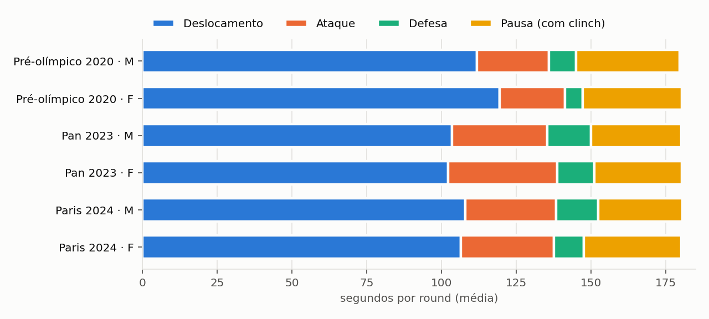
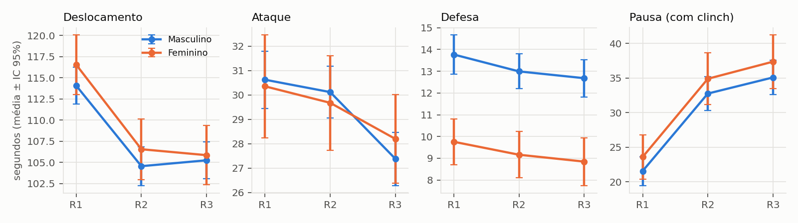
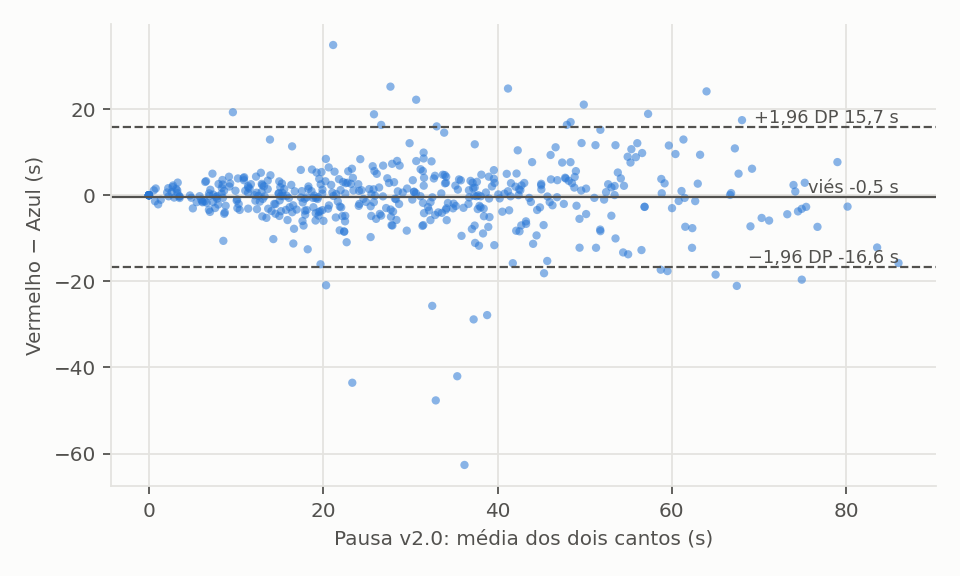

# E2 — Estudo da base MHdS

Gerado por `src/estudo_base.py` a partir de `data/referencia/rounds_2023_2024.csv` e `rounds_2020.csv` (anotação manual v1.0). Não editar à mão: rodar o script de novo.

## 1. Amostra

| Competição | Masc. (lutas / linhas) | Fem. (lutas / linhas) | Contagens? | Lutas por fase |
|---|---|---|---|---|
| Pré-olímpico 2020 | 30 / 143 | 19 / 105 | não | Final 11, Quartas 18, Semifinal 20 |
| Pan 2023 | 20 / 120 | 13 / 78 | sim | Final 5, Oitavas 3, Quartas 10, Semifinal 15 |
| Paris 2024 | 77 / 456 | 22 / 132 | sim | Final 11, Oitavas 44, Quartas 20, R32 16, Semifinal 8 |

Total: 181 lutas, 1034 linhas (atleta × round). Em 488 rounds os dois cantos foram anotados (base da seção 6). **Tóquio 2020 não está na base**; o ciclo de Tóquio é representado pela eliminatória europeia de 2020, que só tem quartas, semifinais e finais e não tem contagens.

## 2. Perfil médio por round

Tempo médio de cada estado v2.0 num round, por competição e sexo (M/F).

Ciclo de Paris (Pan 2023 + Paris 2024), média ± desvio padrão por atleta × round:

| Variável | Masculino | Feminino |
|---|---|---|
| t deslocamento (s) | 107,0 ± 17,3 | 104,8 ± 18,0 |
| t ataque (s) | 30,7 ± 8,2 | 33,2 ± 9,3 |
| t defesa (s) | 14,2 ± 6,6 | 11,0 ± 5,2 |
| t clinch (s) | 13,8 ± 11,8 | 16,0 ± 11,3 |
| t pausa (s) | 14,8 ± 10,0 | 15,3 ± 11,4 |
| t pausa v2.0 (s) | 28,6 ± 18,1 | 31,3 ± 19,5 |
| n deslocamento | 62,7 ± 13,3 | 54,2 ± 11,5 |
| n ataque | 68,9 ± 20,5 | 67,7 ± 19,8 |
| n defesa | 31,3 ± 15,0 | 22,3 ± 10,5 |
| n clinch | 4,8 ± 3,8 | 5,8 ± 4,0 |
| n pausa | 3,9 ± 2,3 | 3,7 ± 2,5 |
| n pausa v2.0 | 8,7 ± 5,4 | 9,5 ± 5,9 |

- Ritmo de ataque: 22,9 ações ofensivas por minuto (DP 6,8).
- Duração mediana por ação: ataque 0,45 s, defesa 0,46 s (referência para as janelas da E5).
- Clinch é 49% do tempo de pausa v2.0 em Paris e 52% no pré-olímpico 2020.

## 3. Efeito do round (cansaço / estratégia)

Modelo misto `variável ~ round + sexo + competição`, intercepto aleatório por luta. R2 e R3 são diferenças em relação ao R1, já descontados sexo e competição. Tempos usam as 3 competições; contagens, só 2023–2024.

| Variável | Média R1 | R2 − R1 | R3 − R1 | p (R3, Holm) |
|---|---|---|---|---|
| t deslocamento (s) | 114,8 | -9,8 | -9,5 | < 0,001 |
| t ataque (s) | 30,5 | -0,6 | -3,0 | < 0,001 |
| t defesa (s) | 12,5 | -0,8 | -1,1 | 0,014 |
| t clinch (s) | 11,2 | +5,9 | +5,9 | < 0,001 |
| t pausa (s) | 11,0 | +5,4 | +7,7 | < 0,001 |
| t pausa v2.0 (s) | 22,2 | +11,2 | +13,6 | < 0,001 |
| n deslocamento | 61,4 | -0,2 | -2,6 | < 0,001 |
| n ataque | 70,2 | +0,3 | -5,0 | < 0,001 |
| n defesa | 29,7 | -0,9 | -1,7 | 0,105 |
| n clinch | 3,9 | +1,8 | +1,8 | < 0,001 |
| n pausa | 3,0 | +1,2 | +1,4 | < 0,001 |
| n pausa v2.0 | 6,9 | +3,0 | +3,1 | < 0,001 |

## 4. Ciclos olímpicos × sexo (objetivo 3.2.3 da proposta)

Médias por round (s):

| Variável | Tóquio · M | Tóquio · F | Paris · M | Paris · F |
|---|---|---|---|---|
| t deslocamento (s) | 111,9 | 119,4 | 107,0 | 104,8 |
| t ataque (s) | 24,1 | 21,9 | 30,7 | 33,2 |
| t defesa (s) | 9,1 | 5,8 | 14,2 | 11,0 |
| t clinch (s) | 18,4 | 16,9 | 13,8 | 16,0 |
| t pausa (s) | 16,1 | 16,3 | 14,8 | 15,3 |
| t pausa v2.0 (s) | 34,5 | 33,2 | 28,6 | 31,3 |

Modelo misto `tempo ~ sexo × ciclo + round`, intercepto aleatório por luta. Cada célula: diferença em segundos (p corrigido por Holm entre as 6 variáveis). A interação diz se a diferença entre os ciclos é outra para as mulheres.

**Todas as fases:**

| Variável | Paris − Tóquio (homens) | Fem. − Masc. (Tóquio) | Interação sexo × ciclo |
|---|---|---|---|
| t deslocamento (s) | -2,6 (0,411) | +9,9 (0,105) | -12,3 (0,088) |
| t ataque (s) | +6,3 (< 0,001) | -2,6 (0,519) | +5,1 (0,082) |
| t defesa (s) | +5,2 (< 0,001) | -3,3 (0,028) | +0,1 (1,000) |
| t clinch (s) | -5,3 (0,053) | -2,1 (1,000) | +4,4 (0,868) |
| t pausa (s) | -2,1 (0,411) | -0,4 (1,000) | +0,9 (1,000) |
| t pausa v2.0 (s) | -7,5 (0,075) | -2,6 (1,000) | +5,5 (0,989) |

**Só quartas, semifinais e finais** (as fases que existem nos dois ciclos):

| Variável | Paris − Tóquio (homens) | Fem. − Masc. (Tóquio) | Interação sexo × ciclo |
|---|---|---|---|
| t deslocamento (s) | -3,5 (0,329) | +10,0 (0,139) | -11,5 (0,395) |
| t ataque (s) | +7,1 (< 0,001) | -2,7 (0,573) | +3,0 (1,000) |
| t defesa (s) | +5,9 (< 0,001) | -3,3 (0,052) | -1,5 (1,000) |
| t clinch (s) | -5,2 (0,140) | -2,1 (1,000) | +4,7 (1,000) |
| t pausa (s) | -3,0 (0,209) | -0,4 (1,000) | +3,8 (1,000) |
| t pausa v2.0 (s) | -8,3 (0,140) | -2,6 (1,000) | +8,6 (1,000) |

Cuidados: o ciclo de Tóquio é só a eliminatória europeia (não os Jogos), com outras categorias de peso e outro grupo de anotação possível; diferença de ciclo e de evento estão confundidas. Só tempos (2020 não tem contagens).

## 5. Vencedor × perdedor

Pares do mesmo round (os dois cantos anotados), todas as competições. dz = diferença média ÷ desvio padrão das diferenças (efeito pareado); p de Wilcoxon com Holm.

| Variável | Rounds | Vencedor | Perdedor | dz | p (Holm) |
|---|---|---|---|---|---|
| t deslocamento (s) | 479 | 108,5 | 108,6 | -0,01 | 1,000 |
| t ataque (s) | 479 | 29,8 | 29,5 | 0,03 | 1,000 |
| t defesa (s) | 479 | 12,0 | 12,3 | -0,04 | 1,000 |
| t clinch (s) | 479 | 15,2 | 14,9 | 0,04 | 1,000 |
| t pausa (s) | 479 | 14,7 | 15,0 | -0,05 | 1,000 |
| t pausa v2.0 (s) | 479 | 29,9 | 30,0 | -0,00 | 1,000 |
| n deslocamento | 378 | 60,1 | 60,8 | -0,09 | 1,000 |
| n ataque | 378 | 68,6 | 68,9 | -0,01 | 1,000 |
| n defesa | 378 | 29,1 | 28,9 | 0,01 | 1,000 |
| n clinch | 378 | 5,1 | 5,1 | 0,01 | 1,000 |
| n pausa | 378 | 3,8 | 3,8 | 0,05 | 1,000 |
| n pausa v2.0 | 378 | 9,0 | 8,9 | 0,02 | 1,000 |

Vencedor = vencedor da LUTA (a base não traz o vencedor de cada round). Clinch e pausa servem de controle: são eventos dos dois atletas, então não deveriam diferir. Nenhuma variável de volume ou tempo separa vencedor de perdedor: no boxe olímpico os juízes pontuam qualidade e efetividade, que a planilha não mede (golpe certo × errado fica para a E8).

## 6. Confiabilidade da anotação manual (piso de erro)

Clinch e pausa acontecem para os dois atletas ao mesmo tempo: as linhas Vermelho e Azul do mesmo round deveriam ser iguais. A diferença entre elas mede o erro da própria anotação manual. É a referência de "bom o suficiente" para o automático (E5/E6) e responde às métricas de concordância da proposta (ICC, Bland–Altman).

| Variável | Rounds | |V − A| médio | |V − A| mediano | Viés V − A | ± LoA 95% | ICC(A,1) |
|---|---|---|---|---|---|---|
| t clinch (s) | 488 | 4,2 | 2,3 | -0,2 | 13,2 | 0,85 |
| t pausa (s) | 488 | 3,4 | 2,2 | -0,3 | 10,1 | 0,88 |
| t pausa v2.0 (s) | 488 | 5,0 | 3,0 | -0,5 | 16,2 | 0,91 |
| n clinch | 384 | 1,3 | 1,0 | -0,1 | 4,4 | 0,83 |
| n pausa | 384 | 0,4 | 0,0 | -0,0 | 1,9 | 0,92 |
| n pausa v2.0 | 384 | 1,5 | 1,0 | -0,2 | 5,2 | 0,89 |

Leitura: ICC ≥ 0,75 é concordância boa, ≥ 0,90 excelente (Koo & Li, 2016). Para o ataque, a defesa e o deslocamento, que são de cada atleta, não há como medir isso na base: falta um segundo anotador no mesmo round (V2 do formulário).

## 7. Estilos (primeiro agrupamento)

Perfil de cada atleta em cada luta (média dos rounds, ciclo de Paris), 7 medidas padronizadas, k-means. Silhueta por k: k=2 0,25, k=3 0,23, k=4 0,21, k=5 0,19, k=6 0,19 → k = 2.

| Grupo | Marca (maiores desvios) | Perfis | % tempo em ataque | % tempo em defesa | % tempo em pausa | ataques/min | defesas/min | s por ação ofensiva | trechos de desl./min | Vitórias | Mulheres |
|---|---|---|---|---|---|---|---|---|---|---|---|
| 1 | trechos de desl./min alto · ataques/min alto | 103 | 19,8 | 8,8 | 12,7 | 27,3 | 12,2 | 0,44 | 23,8 | 54% | 19% |
| 2 | trechos de desl./min baixo · ataques/min baixo | 157 | 15,9 | 6,5 | 18,6 | 19,9 | 7,9 | 0,48 | 17,7 | 48% | 31% |

Estilo × resultado: χ² = 0,84, p = 0,361. Silhueta 0,25: até ~0,25 os grupos são fracos (os atletas formam um contínuo, não tipos separados). O perfil do lutador (E7) deve usar a posição do atleta em cada escala (percentil na base), não um rótulo de grupo.
